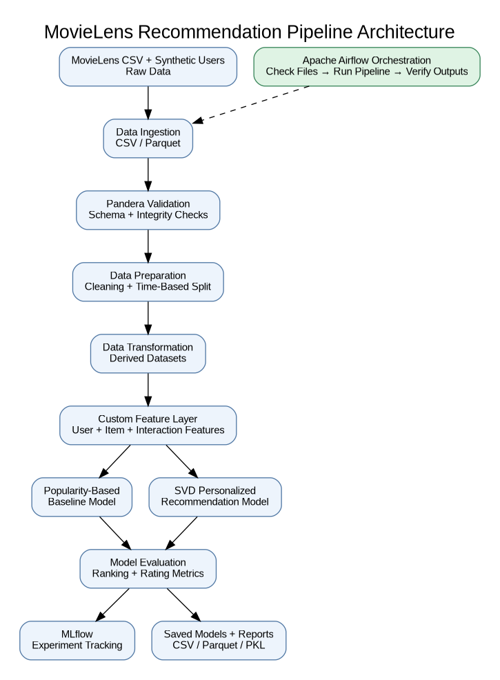

# End-to-End Data Management Pipeline for a Recommendation System

## 1. Project Overview

This project implements end-to-end data management pipeline
for a movie recommendation system using the MovieLens Latest
Small dataset.

The project was developed for Data Management for Machine
Learning (DMML) Assignment 2.

The pipeline covers:

1. Data ingestion
2. Data validation
3. Data preparation
4. Data transformation
5. Feature management
6. Model training
7. Model evaluation
8. MLflow experiment tracking
9. Apache Airflow orchestration

## 2. Dataset Description

**Dataset:** MovieLens Latest Small

**Source:** https://grouplens.org/datasets/movielens/latest/

Original dataset files:

- movies.csv
- ratings.csv
- tags.csv
- links.csv

A synthetic users.csv dataset was also generated.

Dataset statistics:

| Dataset | Records |
|---|---:|
| Movies | 9,742 |
| Ratings | 100,836 |
| Tags | 3,683 |
| Synthetic Users | 610 |

The data is stored in CSV and Parquet formats.

## 3. Technology Stack

| Component | Technology |
|---|---|
| Programming Language | Python |
| Development Environment | Google Colab |
| Data Processing | Pandas, NumPy |
| Data Validation | Pandera |
| Storage | CSV, Parquet |
| Feature Management | Custom Feature Store |
| Recommendation Models | Popularity-Based, SVD |
| Model Library | Surprise |
| Experiment Tracking | MLflow |
| Orchestration | Apache Airflow |
| Evaluation | Custom Metrics, Scikit-learn |
| Architecture Diagram | Graphviz |

## 4. Project Architecture

The pipeline follows these stages:

Data Ingestion
-> Data Validation
-> Data Preparation
-> Data Transformation
-> Feature Management
-> Model Training
-> Model Evaluation

MLflow tracks experiments and Apache Airflow orchestrates
pipeline execution.

The architecture diagram is available below:

A PDF version is also available at:

reports/pipeline_architecture.pdf

## 5. Data Ingestion

The pipeline ingests MovieLens CSV datasets and synthetic
user information.

The datasets are stored in:

- data/raw/
- data/processed/

Processed datasets are also saved in Parquet format.

## 6. Data Validation

Pandera is used for schema validation.

Validation checks include:

- Missing values
- Duplicate records
- Data types
- Rating constraints
- Referential integrity
- Dataset consistency

Validation and integrity reports are saved in reports/.

## 7. Data Preparation

The ratings dataset is divided using a chronological
80/20 train-test split.

| Dataset | Records |
|---|---:|
| Training interactions | 80,668 |
| Testing interactions | 20,168 |

This approach supports time-based recommendation evaluation.

## 8. Data Transformation

The pipeline prepares derived datasets for downstream
feature managemnt, training and evaluation.

The transformation logic is implemented in src/transformation/.

## 9. Feature Management

A custom feature management layer generates reusable
user, item, and interaction features.

| Feature Dataset | Records |
|---|---:|
| User Features | 522 |
| Item Features | 7,867 |
| Interaction Features | 80,668 |

Feature datasets are saved in:

data/features/

The feature catalog contains 14 entries and is available at:

reports/feature_catalog.csv

## 10. Recommendation Models

### 10.1 Popularity-Based Model

The popularity model provides a non-personalized
recommendation baseline using historical movie popularity.

### 10.2 SVD Model

The SVD model uses collaborative filtering through
the Surprise library to generate personalized predictions.

Both models are trained using the training interactions.

## 11. Model Evaluation

The evaluation framework includes:

- Precision@10
- Recall@10
- NDCG@10
- Coverage
- Diversity
- RMSE
- MAE

The models are compared using saved evaluation results.

Evaluation report:

reports/model_evaluation_results.csv

## 12. Experiment Tracking

MLflow is used to track:

- Experiment runs
- Model parameters
- Evaluation metrics
- Model artifacts
- Pipeline execution details

The local execution environment uses SQLite-backed
MLflow tracking.

Runtime MLflow databases and artifacts are not intended
to be committed to GitHub.

## 13. Pipeline Execution

The main pipeline entry point is:

pipeline_execution.py

### 13.1 Full Pipeline Execution

Run the complete pipeline, including model training:

    python pipeline_execution.py --full-run

This generates trained models and evaluation outputs.

### 13.2 Dry-Run Execution

Run the pipeline using existing saved models:

    python pipeline_execution.py

Dry-run mode does not retrain models or overwrite
existing trained model artifacts.

A successful full run is required before the dry run
can reuse saved models.

## 14. Apache Airflow Orchestration

The orchestration DAG is located at:

dags/movielens_pipeline_dag.py

The DAG contains three dependent tasks:

1. check_project_files
2. run_recommendation_pipeline
3. verify_pipeline_outputs

The Airflow DAG executes the pipeline in dry-run mode.

The DAG was tested successfully using:

    airflow dags test movielens_recommendation_pipeline

All three tasks completed successfully.

Execution evidence:

reports/airflow_execution_evidence.json

The successful DAG execution was also documented
with screenshots captured in Google Colab.

## 15. Installation Instructions

The project was developed in Google Colab.

Clone the repository:

    git clone https://github.com/Aviral-Saxena905/recommendation-pipeline.git

Navigate to the project directory:

    cd recommendation-pipeline

Install core dependencies:

    pip install -r requirements.txt

Apache Airflow must be installed separately using
the appropriate version-specific constraints file.

The implementation was tested with Apache Airflow 3.4.0
in Google Colab.

For Airflow 3.4.0 with Python 3.13, an example is:

    pip install "apache-airflow==3.4.0" --constraint "https://raw.githubusercontent.com/apache/airflow/constraints-3.4.0/constraints-3.13.txt"

The MovieLens CSV datasets must be placed in data/raw/.

### Preparing the Input Datasets

1. Download MovieLens Latest Small from https://grouplens.org/datasets/movielens/latest/.
2. Extract 'movies.csv', 'ratings.csv', 'tags.csv' and 'links.csv' into 'data/raw/.
3. Run the synthetic-user generation step in 'notebooks/01_Data_Ingestion.ipynb' to create 'data/raw/users.csv'.
4. Run 'python pipeline_execution.py --full-run' to train the models and generate the pipeline outputs.
5. Run the Airflow DAG after the full pipeline has generated the saved models and evaluation results.
   
Raw datasets, generated features, and trained model binaries are intentionally excluded from the GitHub repository.

The Airflow DAG currently uses a Google Colab-specific
project path. Update PROJECT_DIR when running elsewhere.

Google Drive must be mounted when using the original
Colab project directory.

## 16. Project Structure

    recommendation-pipeline/
    |
    |-- configs/
    |-- dags/
    |-- data/
    |   |-- raw/
    |   |-- processed/
    |   |-- features/
    |   |-- errors/
    |-- models/
    |-- notebooks/
    |-- pipeline_runs/
    |-- reports/
    |-- src/
    |   |-- ingestion/
    |   |-- validation/
    |   |-- preparation/
    |   |-- transformation/
    |   |-- features/
    |   |-- training/
    |   |-- evaluation/
    |-- pipeline_execution.py
    |-- run_pipeline.py
    |-- requirements.txt
    |-- README.md

## 17. Important Deliverables

The repository includes or documents:

- Modular pipeline source code
- Configuration files
- Data validation reports
- Feature catalog
- Model evaluation results
- MLflow experiment tracking
- Airflow DAG
- Successful orchestration execution evidence
- Architecture diagram
- Google Colab notebooks
- Final 3-page assignment report:
  [2025AG05387_DM4ML_Assignment_2_Final_Report.pdf](reports/2025AG05387_DM4ML_Assignment_2_Final_Report.pdf)

## 18. Limitations

- The project uses the MovieLens Latest Small dataset.
- User demographic information is synthetic.
- The popularity baseline does not personalize recommendations.
- SVD depends on historical user-item interactions.
- Google Colab runtimes are temporary.
- The Airflow DAG uses a dry-run wrapper around the pipeline.
- Existing trained models are required for dry-run evaluation.
- The current DAG contains environment-specific paths.

## 19. Future Improvements

Potential enhancements include:

- Support for larger datasets
- Richer user and movie features
- Hybrid recommendation models
- Improved coverage and diversity
- Implement automated monitoring and alerts for pipeline failures, data quality issues, and model performance degradation.

## 20. Assignment

Data Management for Machine Learning (DMML)

Assignment 2:

End-to-End Data Management Pipeline for a Recommendation System.
